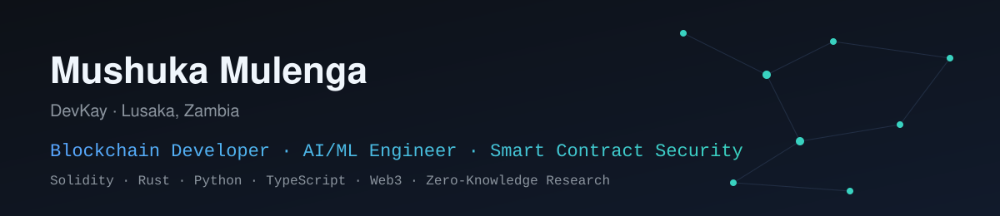
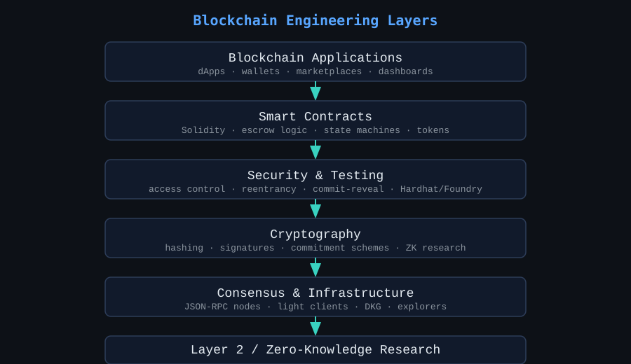
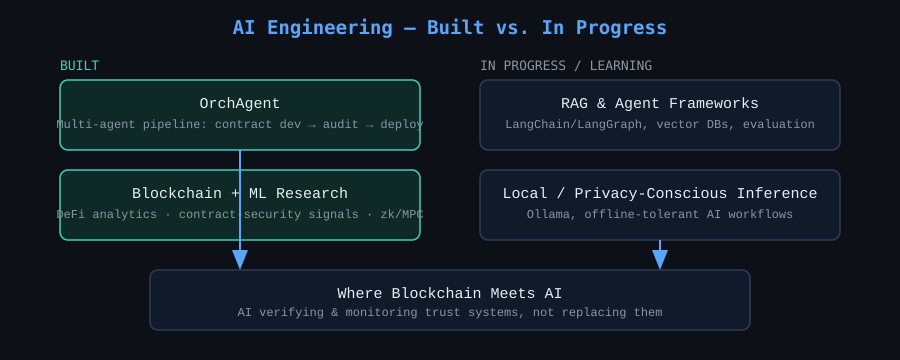
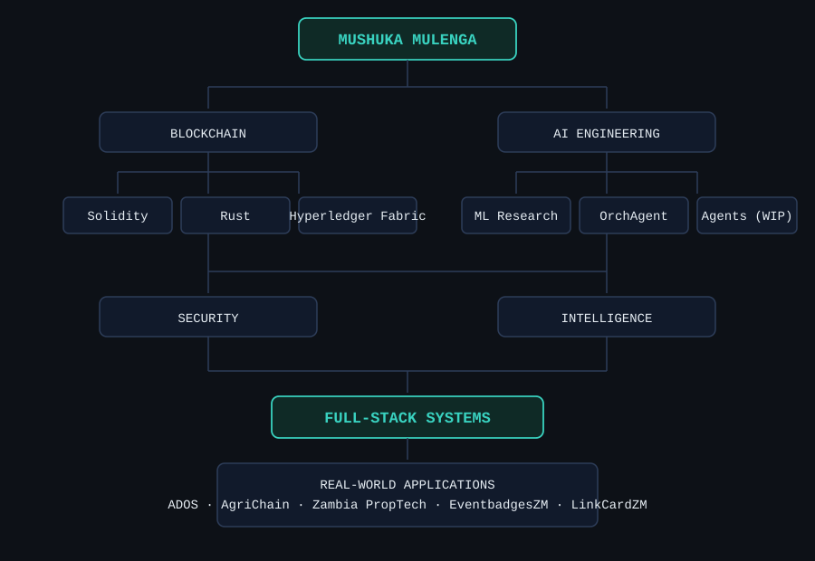
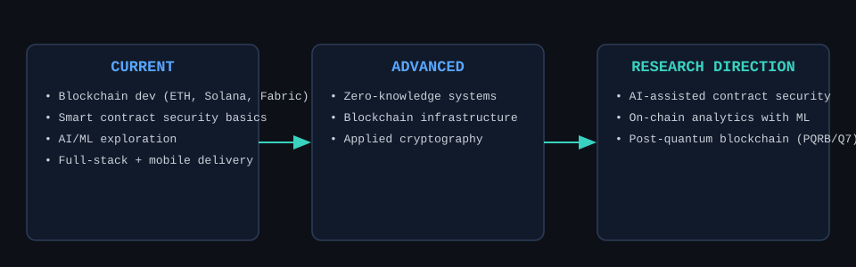

<div align="center">



# Hi, I'm Mushuka Mulenga (DevKay)

### Blockchain Developer · AI/ML Engineer · Smart Contract Security

I build decentralized systems, security-aware smart contracts, and intelligent
applications — with a focus on problems in Zambia and across Africa.

**Solidity · Rust · Python · TypeScript · Smart Contracts · Blockchain Security · AI/ML · Web3**

[](https://github.com/shux187)

</div>

---

> **A note on how this README was built:** every project, repo name, and stat below is either
> (a) verified directly from the public `shux187` GitHub profile, or (b) a project name the
> repository owner confirmed is live on GitHub. GitHub blocks automated tools from crawling the
> full repositories tab, so exact repo URLs for the confirmed-but-unverified projects are marked
> `TODO: confirm exact repo link` — fill these in from your own repo list before publishing, per
> your own no-fabrication rule. See `docs/portfolio-map.md` for the full verification log.

## Who I Am

I'm a Software Engineering student (BSc, ZCAS University — School of Computing, Technology &
Applied Sciences) based in Lusaka, Zambia, working across blockchain development, applied
cryptography, AI/ML, full-stack/mobile engineering, and cybersecurity. My work centers on a
simple loop:

```
Research → Engineering → Implementation → Security → Testing → Deployment → Real-world use
```

I don't treat blockchain and AI as two separate skill lists — most of what I build sits where
they intersect: systems that need verifiable trust (smart contracts, cryptographic proofs) and
systems that need intelligence and automation (AI agents, analytics) layered on top of them.

## Engineering Thesis

I build systems where computation, trust, automation, and security intersect — not demos, and
not one-off scripts. That means:

- **Decentralized trust**: state machines and escrow logic that hold up when adversarial actors
  interact with them, not just the happy path.
- **Smart contract correctness**: access control, reentrancy, replay, and arithmetic risk treated
  as first-class design constraints, not an afterthought before "audit."
- **AI-assisted systems**: agents and pipelines that automate parts of the engineering workflow
  itself (contract development, review, deployment) rather than just answering questions.
- **Real-world constraints**: mobile-first, low-bandwidth, and offline-tolerant design, because a
  lot of the problems worth solving in Zambia and across Africa don't assume always-on broadband.
- **Honesty about maturity**: research prototypes are labeled as research prototypes. Nothing
  here is presented as production or audited unless it explicitly is.

## Engineering Focus

**Blockchain Engineering** — Ethereum · Solidity · EVM · JSON-RPC · Web3.js/Ethers · dApps ·
wallets · escrow · tokenization · Solana (Anchor) · Hyperledger Fabric · smart-contract state
machines

**Blockchain Security** — Hardhat/Foundry testing · access-control review · reentrancy analysis ·
commit-reveal patterns (replay/front-running mitigation) · signature verification · secure
randomness design

**Cryptography & ZK (research)** — hashing & Merkle structures · digital signatures (ECDSA) ·
commitment schemes · zero-knowledge proof concepts · zk-rollup and SNARK-friendly hash research ·
distributed key generation · verifiable delay functions

**AI / ML** — Python · multi-agent pipelines · applied ML for blockchain analytics (DeFi/security
use cases) — see [Where Blockchain Meets AI](#where-blockchain-meets-ai) below

**Backend & Full-Stack** — Python · Node.js/TypeScript · NestJS · Fastify · REST APIs ·
PostgreSQL · Flutter · React / React Native · Next.js

**DevOps & Tooling** — Docker · Git/GitHub · Linux · CI/CD basics

*(Only technologies backed by an actual project below are listed here — this is not a generic
badge wall.)*

## Blockchain Engineering

My blockchain work spans several layers, from protocol-level research prototypes to full-stack
applications with contracts, backends, and mobile/web frontends:

```
Blockchain Applications  →  Smart Contracts  →  Security & Testing
       →  Cryptography  →  Consensus & Infrastructure  →  Layer 2 / ZK Research
```



### Featured Blockchain Projects

Status labels — 🟢 Production-oriented · 🔵 Active development · 🟡 Research prototype ·
🟣 Experimental · ⚪ Educational. No project below is labeled production unless it has a real
deployment; most of this portfolio is prototype/research-stage by design (it's a learning and
R&D portfolio, and it says so honestly).

| Project | Domain | Technologies | What It Demonstrates | Status | Repo |
|---|---|---|---|---|---|
| **ADOS** (Automotive Dealership Operating System) | Enterprise SaaS / Full-stack | Multi-tenant architecture | Multi-tenant SaaS design for Zambian car dealerships | 🔵 Active | `TODO: confirm repo link` |
| **BADD** (BenAuto Digital Dealership Platform) | Full-stack Web app | TBD stack per repo | Dealership platform prototype, scope-constrained build | 🟡 Prototype | `TODO: confirm repo link` |
| **OEBP** (OmniLedger Enterprise Blockchain Platform) | Blockchain Infrastructure | Architecture/spec | Enterprise blockchain platform architecture & spec | 🟡 Research | `TODO: confirm repo link` |
| **Ethereum Transaction Lifecycle Tracker** | Blockchain Infrastructure | Flutter, NestJS, Ethereum JSON-RPC | Tracks a transaction from broadcast → mempool → block inclusion → finality | 🔵 Active | `TODO: confirm repo link` |
| **Blockchain Node Explorer** | Blockchain Infrastructure | Flutter, TypeScript/Fastify | Block/transaction/account inspection over JSON-RPC | 🔵 Active | `TODO: confirm repo link` |
| **Zambia Real Estate Intelligence & Property Marketplace** | Full-stack / PropTech | Web app, mandated stack (see repo) | Real-estate marketplace & property intelligence for the Zambian market | 🔵 Active | `TODO: confirm repo link` |
| **7D Blockchain Post-Quantum Security Architecture (PQRB / Q7)** | Cryptography / Research | Post-quantum crypto, BFT consensus, cross-chain, SDKs | Post-quantum-secure blockchain architecture research | 🟡 Research | `TODO: confirm repo link` |
| **Commitment** | Smart Contracts / Cryptography | Solidity, Hardhat, React | Full-stack commit-reveal cryptographic scheme demo | 🟡 Prototype | `TODO: confirm repo link` |
| **OutSourcer2 (OutSourcer)** | Smart Contracts / Web3 | Solidity, Hardhat, Web3 frontend | Decentralized freelance marketplace with escrow logic | ⚪ Educational | `TODO: confirm repo link` |
| **Timestamp Notary Builder** | Blockchain Tooling | Solidity, Rust, Go, React Native | Cross-language notarization tooling (contracts + CLIs + mobile) | 🟡 Prototype | `TODO: confirm repo link` |
| **MultiSig Wallet** | Wallet Infrastructure | React Native/Expo | Multi-signature wallet app to a strict spec-sheet UI | 🟡 Prototype | `TODO: confirm repo link` |
| **Smart Contract Randomness Oracle** | Smart Contracts / Security | Commit-reveal, contract + web + mobile + CLI | Commit-reveal randomness oracle across four surfaces | 🟡 Prototype | `TODO: confirm repo link` |
| **Zero-Knowledge Age Verification** | Cryptography / ZK | Web dashboard + React Native | ZK-based age verification system | 🟡 Research prototype | `TODO: confirm repo link` |
| **Smart Contract Gas Cost Analyzer** | Blockchain Security / Tooling | Solidity, Hardhat, web + React Native | Gas-cost benchmarking across contract variants | 🟡 Prototype | `TODO: confirm repo link` |
| **CertChain** | Blockchain Applications | Group project (4 members) | Blockchain-based certificate verification system | ⚪ Educational | `TODO: confirm repo link` |
| **AgriChain** | Blockchain Applications / AgTech | Group project (CS 420) | Transparent agricultural supply-chain tracking for Zambian farmers & exporters | ⚪ Educational | `TODO: confirm repo link` |
| **EventbadgesZM** | Web3 Applications | Anchor, Next.js, Solana | Soul-bound NFT badge dApp built for the Zambia Blockchain Summit | 🔵 Active | `TODO: confirm repo link` |
| **LinkCardZM (Onchain Network Card)** | Web3 Applications | Anchor, Next.js, Solana | NFT-based digital business card app for the Zambia Blockchain Summit | 🟡 Active (mid-build) | `TODO: confirm repo link` |

*(Verified public repos not yet listed above — `Tokenized_Real_Estate_Ownership`, `Asset_Tokenizer`,
`Building_a_blockchain_in_Python`, `Smart-Contract-Testing-with-Hardhat` — are folded into the
project matrix further down and kept in the pinned-repo rotation; see
[Pinned Repository Strategy](#pinned-repository-strategy).)*

## Smart Contract Security

Security is treated as a workflow, not a checklist item at the end:

```
Threat Model → Static Review → Unit Tests → (Fuzz/Invariant Tests, where tooling is set up)
   → Manual Review → Remediation → Regression Tests
```

Areas explored across the projects above: access control, reentrancy, replay protection via
commit-reveal schemes, secure randomness (vs. predictable on-chain randomness), signature
verification, and gas-cost analysis as a security-adjacent concern (denial-of-service via gas
griefing). `TODO: verify` — add Slither/Mythril/Foundry fuzzing badges here once those tools are
wired into CI for a given repo; don't claim static/dynamic analysis coverage that isn't actually
running.

## AI Engineering

AI is a second engineering discipline here, not "using ChatGPT to write code":

- **OrchAgent** — a multi-agent AI pipeline automating parts of the smart contract development,
  audit, and deployment workflow. 🟡 Research prototype. `TODO: confirm repo link`
- **Blockchain + ML research** — applied ML directions for DeFi analytics, contract-security
  signal detection, and zk/MPC-adjacent systems. 🟡 Research. `TODO: confirm repo link`

I'm deliberately not listing LangChain/RAG/vector-DB/agent-framework badges here — those are
areas I'm building toward (see [Currently Deepening](#currently-deepening)), not shipped systems,
and this README only claims what's actually built.



## Where Blockchain Meets AI

The throughline across my work: blockchain systems need trust guarantees that AI can help
*verify* and *monitor*, not replace. Concretely, that shows up as:

- Using an AI agent pipeline (OrchAgent) to assist smart-contract development and review.
- Exploring ML for on-chain analytics and DeFi/security signal detection.

This is presented as a direction, not a finished product line — the roadmap below is explicit
about what's current vs. aspirational.

## Cryptography & ZK Research

These are **research prototypes / educational implementations** — labeled as such, not presented
as production protocols:

- Zero-knowledge age verification, zk-identity (zkID), zk-private voting (protocol + system)
- Mini zk-rollup implementation, zk-rollup transaction simulator, SNARK-friendly hash benchmarking
- Cryptographic accumulator for membership proofs, linkable ring signatures
- Verifiable delay function (VDF) implementation
- Distributed key generation (protocol + network variants)
- Optimistic rollup fraud-proof system, stateless Ethereum prototype, Ethereum light client
- Proof-of-work fundamentals visualizer (hashing, nonce search, tamper detection)
- Cryptographic hash collision simulator
- Sealed-bid auction via commit-reveal, blockchain social key recovery

Full list with one-line descriptions: [`docs/blockchain-projects.md`](docs/blockchain-projects.md).
`TODO: confirm repo link` for each before publishing — these are confirmed-live project names
without verified public repo slugs at the time this README was drafted.

## Featured Project Matrix

See the table under [Featured Blockchain Projects](#featured-blockchain-projects) above — kept
as a single table rather than duplicated, per the "signal not volume" principle.

## Technology Stack

**Languages**: Solidity · Python · TypeScript/JavaScript · Rust · Dart · Go (CLI tooling)

**Blockchain**: Ethereum · Solana (Anchor) · Hyperledger Fabric · Hardhat · Foundry (where used)

**Backend**: Node.js · NestJS · Fastify · REST APIs · PostgreSQL

**Frontend / Mobile**: React · Next.js · React Native / Expo · Flutter

**Tooling**: Docker · Git/GitHub Actions · Linux

*(Badges intentionally kept minimal — see `assets/` for a compact tech-stack strip rather than a
wall of 100+ icons.)*

## Architecture Map



## Engineering Roadmap

```
Current
├── Blockchain development (Ethereum, Solana, Hyperledger Fabric)
├── Smart contract security fundamentals
├── AI/ML exploration (agents, blockchain analytics)
└── Full-stack & mobile delivery (Flutter, React/React Native, NestJS)
        │
        ▼
Advanced (in progress)
├── Zero-knowledge systems (rollups, identity, voting)
├── Blockchain infrastructure (light clients, DKG, consensus research)
└── Applied cryptography engineering
        │
        ▼
Research direction
├── AI-assisted smart contract security
├── On-chain analytics with ML
└── Post-quantum blockchain security (PQRB/Q7)
```



## Currently Building

- 🔗 Blockchain infrastructure tooling (node explorer, transaction tracker)
- ⛓️ Enterprise blockchain platform architecture (OEBP)
- 🏠 Zambia real estate marketplace platform
- 🚗 Multi-tenant dealership SaaS (ADOS / BADD)

## Currently Deepening

- Smart contract auditing practice (Slither/Mythril/Foundry fuzzing)
- Zero-knowledge proof systems (SNARKs, rollup design)
- Post-quantum cryptography for blockchain (PQRB/Q7)
- AI agent design for engineering workflows

## Building for Real-World Constraints

A recurring thread across these projects is designing for the constraints that actually matter
in Zambia and similar markets: mobile-first interfaces, tolerance for inconsistent connectivity,
and domain fit for sectors like agriculture (AgriChain), automotive retail (ADOS/BADD), real
estate (the Zambia proptech platform), and civic/event infrastructure (EventbadgesZM, LinkCardZM
at the Zambia Blockchain Summit). No claims are made here about measured impact — this is
engineering context, not an impact study.

## Open Source & Collaboration

- GitHub: [@shux187](https://github.com/shux187)
- Open to collaboration on blockchain security, Web3 tooling, and AI-for-blockchain research.
- Feel free to inspect any repository directly — READMEs are being brought up to the standard in
  [`docs/portfolio-map.md`](docs/portfolio-map.md) on a rolling basis.

## GitHub Stats

<div align="center">


</div>

*(These widgets pull live data from GitHub at render time — no numbers are hardcoded here.)*

## Profile Bio Options

Pick one for the GitHub "bio" field (Settings → Public profile). All three are evidence-based —
none claim a title or expertise level not backed by the record above.

1. `Blockchain Developer & AI/ML Engineer | Solidity · Rust · Python · Smart Contract Security · Web3` *(recommended — matches the README positioning exactly)*
2. `BSc SE student building blockchain + AI systems | Solidity, Ethereum, Solana, Python | Zambia`
3. `Blockchain & AI/ML Engineer-in-training | Smart contracts, Web3, applied cryptography`

## Pinned Repository Strategy

Recommended 6 slots, selected for breadth across domains rather than star count. Repo names in
*italics* are the ones verified live on GitHub today; the rest need their real slug filled in
from `gh repo list` before pinning.

| Slot | Role | Candidate |
|---|---|---|
| 1 | Strongest blockchain project | Ethereum Transaction Lifecycle Tracker *or* Blockchain Node Explorer — pick whichever has the more complete README |
| 2 | Strongest AI project | OrchAgent |
| 3 | Blockchain security project | Commitment (commit-reveal) or *`Asset_Tokenizer`* (Foundry-based) |
| 4 | Full-stack Web3 project | OutSourcer2 or the Zambia Real Estate Marketplace |
| 5 | Advanced infrastructure/research | 7D Blockchain Post-Quantum Security Architecture (PQRB/Q7) |
| 6 | Blockchain + AI intersection | OrchAgent (if not used in slot 2) or the Blockchain + ML research project |

Don't pin by star count — `Agent-1` currently has the most stars (3) but no verified description,
so it shouldn't take a slot until its README explains what it actually does.

## Contact

- GitHub: [@shux187](https://github.com/shux187)
- Location: Lusaka, Zambia
- `TODO`: add LinkedIn / portfolio site / email if you want them public — none were provided, so
  none are invented here.

---

<div align="center">
<sub>Built as an engineering portfolio, not a marketing page. Prototypes are labeled prototypes.</sub>
</div>
